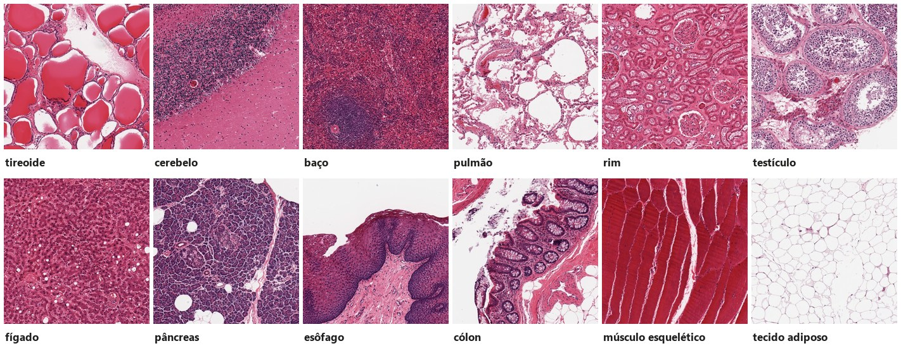
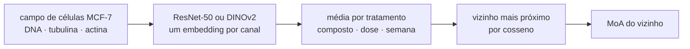
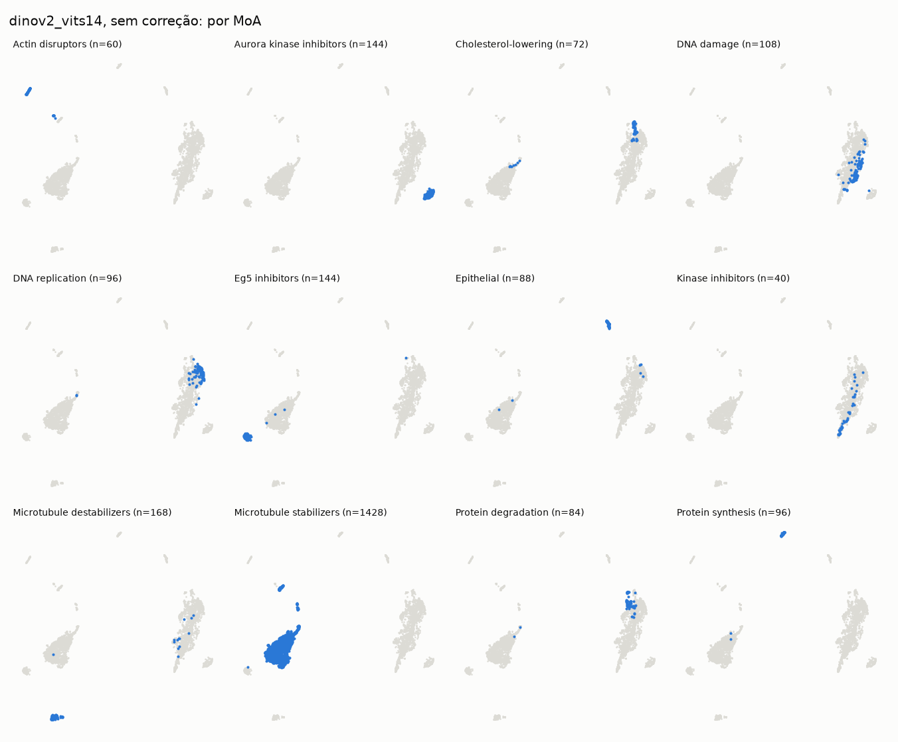
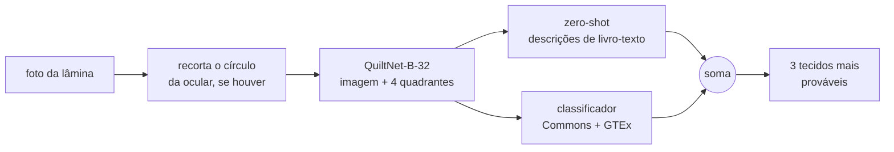
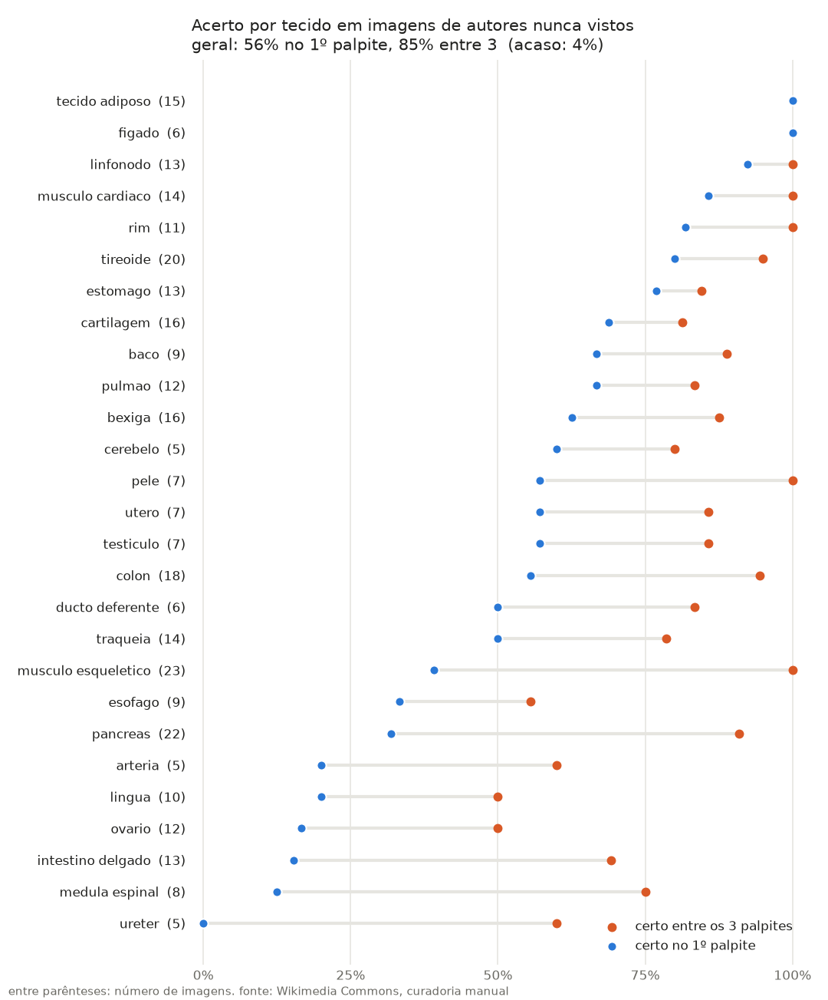

# cellvs

[](https://github.com/richprograming/cellvs/actions/workflows/tests.yml)


**Microscopia lida por modelos pré-treinados, com o acerto medido sem se enganar.**


<sub>12 dos 29 tecidos que o modelo reconhece. Recortes de lâminas do GTEx (CC BY 4.0), escolhidos como exemplos típicos.</sub>

O cellvs faz duas perguntas a imagens de microscopia, usando só modelos abertos que **nunca foram treinados para elas**:

1. **Qual o mecanismo de ação de um remédio**, olhando as células que ele tratou?
2. **Qual tecido está na lâmina**, mesmo numa foto de celular tirada pela ocular do microscópio?

E um app responde as duas ao vivo, inclusive pela câmera.

## Em números

| | Resultado | Ao acaso |
|---|---|---|
| Mecanismo de ação, compostos e semanas nunca vistos (BBBC021, DINOv2) | **83/101** tratamentos (82%) | 6% |
| Tecido, imagens de autores nunca vistos (Wikimedia Commons, 29 tecidos) | **57%** no 1º palpite, **83%** entre 3 | 4% |
| Tecido, lâminas de doadores nunca vistos (GTEx, 22 tecidos) | **58%** no 1º palpite, **78%** entre 3 | 5% |
| Tecido, fotos de celular pela ocular, outras lâminas | **5/8** no 1º palpite, 6/8 entre 3 | 17% |

Nenhum desses números vem de imagens que o modelo viu no treino, nem de imagens "irmãs" delas.

## O cuidado que dá valor aos números

Em microscopia, é fácil um modelo tirar nota alta sem ter aprendido biologia. Basta reconhecer **o dia em que a placa foi feita** ou **a lâmina de onde a foto saiu**. Todo teste daqui fecha esse atalho:

- **Mecanismo de ação.** O vizinho mais próximo não pode ser o mesmo composto (**NSC**), nem da mesma semana de experimento (**NSCB**). Três testes de vazamento tentam provar que o resultado é falso, e nenhum consegue.
- **Tecido.** A validação cruzada separa **autores** inteiros (Commons) e **doadores** inteiros (GTEx). As fotos de um mesmo autor costumam vir da mesma lâmina.
- **Comparações fixadas antes.** Ao trazer o GTEx, escrevi as comparações antes de ver qualquer resultado. Também conto quando algo **não** funcionou.

---

## Parte 1: mecanismo de ação (BBBC021)



O [BBBC021](https://bbbc.broadinstitute.org/BBBC021) tem células de câncer de mama tratadas com 38 compostos de 12 mecanismos de ação. Cada canal de fluorescência passa separado por um modelo de visão já treinado em fotos comuns. Os vetores viram uma média por tratamento, e o mecanismo é o do tratamento mais parecido. **Os rótulos de MoA só servem para dar a nota.**

| modelo | correção | NSC | NSCB |
|---|---|---|---|
| ResNet-50 (ImageNet) | nenhuma | 103/112 (92.0%) | 76/101 (75.2%) |
| ResNet-50 (ImageNet) | centrar no DMSO | 93/112 (83.0%) | 66/101 (65.3%) |
| **DINOv2 ViT-S/14** | **nenhuma** | **107/112 (95.5%)** | **83/101 (82.2%)** |
| DINOv2 ViT-S/14 | centrar no DMSO | 101/112 (90.2%) | 76/101 (75.2%) |

Ao acaso: NSC 6.0%, NSCB 5.8%. O NSCB deixa 11 tratamentos de fora, porque *Cholesterol-lowering* e *Kinase inhibitors* só existem em uma semana.

**Testes de vazamento** ([`3_leak_checks.py`](scripts/3_leak_checks.py)):
- prever o MoA só pela semana dá 11.5%;
- o padrão do DMSO de cada placa dá NSCB perto do acaso;
- embaralhar o MoA dentro de cada semana derruba o NSCB para 13–17%.

Nenhum deles mostrou vazamento pela semana. Há intervalos de confiança por bootstrap sobre compostos.

**O batch effect pesa mais que o modelo?** Centrar no DMSO **piorou** os dois modelos, e o DINOv2 ficou à frente nas duas condições. Num teste exploratório, feito depois de ver esses números, *sphering* com o DMSO mudou o NSCB mais do que trocar de modelo (ResNet 89/101, DINOv2 94/101). Com 38 compostos, é indício, não conclusão.

**Imagens novas** ([`5_holdout.py`](scripts/5_holdout.py)): deixando cada semana inteira de fora, o DINOv2 acerta o MoA de 1702/2416 fotos individuais (70%). A resposta "desconhecido" funciona mal: quando a classe inteira sai da biblioteca, ele só percebe em 161/2528 fotos.


<sub>Mapa 2D (UMAP) dos embeddings do DINOv2, sem nenhum treino: cada painel acende as fotos de um mecanismo de ação. Vários formam ilhas próprias.</sub>

---

## Parte 2: tecido em lâminas de histologia



**Modelo.** O [QuiltNet-B-32](https://huggingface.co/wisdomik/QuiltNet-B-32) é um CLIP treinado com 1 milhão de pares imagem-texto de patologia. Ele põe imagens e frases no mesmo espaço, e a resposta soma duas opiniões:
- **zero-shot, sem treino nenhum:** a foto é comparada com descrições de livro-texto de cada tecido, como *"thyroid with round follicles lined by cuboidal cells and filled with pink colloid"*. Sozinho, acerta 50%.
- **classificador:** uma regressão logística sobre o mesmo embedding, treinada nas imagens públicas.

**Dados.**
- **Wikimedia Commons:** a busca por 30 tecidos trouxe 1096 imagens, a maioria lixo (esquemas, imuno-histoquímica, tecido doente). Olhei uma por uma e fiquei com **316**, listadas em [`commons_curadoria.csv`](scripts/commons_curadoria.csv).
- **[GTEx](https://gtexportal.org/), via [NCI Imaging Data Commons](https://imaging.datacommons.cancer.gov/), CC BY 4.0:** **638 lâminas** de tecido normal, de **464 doadores**, 29 por tecido.
  - Só o nível de ~2 µm/px de cada lâmina é baixado (~30 MB, contra 450 MB da lâmina inteira).
  - Dele saem até 8 recortes de 1 e 2 mm, o campo das objetivas de 10× e 20×. Um filtro de textura garante que é tecido, e não vidro.
  - Depois a lâmina é apagada. Passaram 22 GB pela rede, e ficaram 581 MB de recortes.
  - Cada lâmina pesa no treino como uma imagem do Commons.

| teste | treino do classificador | 1º palpite | entre 3 |
|---|---|---|---|
| Commons (autores nunca vistos) | só zero-shot | 159/316 (50.3%) | 264/316 (83.5%) |
| | Commons | 177/316 (56.0%) | 270/316 (85.4%) |
| | **Commons + GTEx (final)** | **180/316 (57.0%)** | **261/316 (82.6%)** |
| GTEx (doadores nunca vistos) | só zero-shot | 2121/5059 (41.9%) | 3348/5059 (66.2%) |
| | Commons | 2162/5059 (42.7%) | 3105/5059 (61.4%) |
| | **Commons + GTEx (final)** | **2957/5059 (58.5%)** | **3956/5059 (78.2%)** |
| fotos de celular pela ocular | Commons | 5/8 | 6/8 |
| | **Commons + GTEx (final)** | **5/8** | **6/8** |

**O GTEx ajudou?** Nas lâminas escaneadas, muito: de 42.7% para 58.5%. Nas imagens do Commons, quase nada, e o acerto entre 3 caiu. Nas fotos do laboratório, nada. Fiquei com o modelo novo porque ele cobre 2 tecidos a mais (nervo e córtex cerebral) e empata no resto. Há duas explicações prováveis:
- **Rótulo pelo local de coleta.** O GTEx rotula pela região de onde tirou a amostra, não pelo que aparece no recorte. Bexiga e intestino delgado acertam 1% e 3% no GTEx, provavelmente porque os recortes mostram só a parede muscular.
- **Imagem diferente.** Uma lâmina escaneada não se parece com uma foto pela ocular.



<details>
<summary><b>O que não funcionou</b>, medido do mesmo jeito</summary>

- **PLIP e BiomedCLIP no zero-shot.** O BiomedCLIP chamou cerebelo de cartilagem com 94% de certeza.
- **QuiltNet-B-16, o modelo maior:** 45–48%, contra 49–56% do B-32.
- **Phikon-v2, um ViT-L de patologia:** 54% sozinho, 55% junto com o QuiltNet, e só 3/8 e 4/8 nas fotos de celular.
- **Vizinho mais próximo pelo DINOv2:** 30%.
- **Filtrar as imagens do Commons com o próprio CLIP:** deixou passar muito lixo, por isso a curadoria foi manual.
</details>

**Ressalvas.**
- **Escolha nas mesmas imagens:** a configuração final foi a melhor de 8 testadas nas imagens do Commons, então lá o acerto real deve ser um pouco menor.
- **Poucas fotos do laboratório:** são só 8, de 6 tecidos.
- **Tecidos mais fracos:** artéria, medula espinal, ureter, intestino delgado e ovário ainda erram muito no 1º palpite.
- **Fora do GTEx:** osso, cartilagem, ducto deferente, língua, linfonodo, medula espinal, traqueia e ureter não existem no GTEx e dependem só do Commons.
- **O que mais ajudaria:** fotos tiradas pela ocular, nas mesmas condições de uso, com 3 a 5 por tecido em `data/tecidos/<tecido>/`. Elas entram como teste externo e depois no treino.

---

## App

```bash
python app.py        # http://127.0.0.1:7860
```

| aba | o que faz |
|---|---|
| **Tecido** | foto enviada, colada ou da webcam: mostra o que o modelo viu e os 5 tecidos mais prováveis |
| **Tecido ao vivo** | aponte a câmera para a ocular, e ela é analisada uma vez por segundo |
| **MoA** | um campo de 3 canais, com os tratamentos mais parecidos do BBBC021 |
| **Quanto acerta** | as tabelas de resultado |

Sem nenhum dado baixado, o app ainda responde tecido pelo zero-shot.

## Rodando tudo

```bash
pip install -r requirements.txt
pytest
```

<details>
<summary><b>Parte 1: BBBC021</b></summary>

```bash
# metadados em https://bbbc.broadinstitute.org/BBBC021 (BBBC021_v1_image.csv e BBBC021_v1_moa.csv em data/raw)
python scripts/0_prepare_metadata.py --raw data/raw
python scripts/download_images.py --meta data/metadata.csv --raw data/raw   # 3848 imagens, 29 GB, retoma se parar
python scripts/1_embed.py --img-root data/raw --backbone dinov2_vits14      # ~24 min em CPU (Ryzen 5 4600G)
python scripts/1_embed.py --img-root data/raw --backbone resnet50
python scripts/2_evaluate.py --emb results/emb_dinov2_vits14.npy [--no-center]
python scripts/3_leak_checks.py
python scripts/5_holdout.py
python scripts/predict.py --input pasta/ [--watch]                          # azul = DNA, verde = tubulina, vermelho = actina
python scripts/4_build_demo.py                                              # demo/index.html, apresentação interativa
```

Para GPU, há [`00_colab_embeddings.ipynb`](notebooks/00_colab_embeddings.ipynb) (ainda não testado no Colab). Os UMAPs estão em [`01_umap.ipynb`](notebooks/01_umap.ipynb).
</details>

<details>
<summary><b>Parte 2: tecidos</b></summary>

```bash
python scripts/fetch_commons.py          # ~1100 imagens, ~330 MB, data/commons + creditos.csv
python scripts/fetch_gtex.py --gb 20     # ~640 lâminas, ~30 min; só os recortes ficam (data/gtex, ~580 MB)
python scripts/tissue_train.py           # avaliação + models/tissue_clf.npz, ~30 min em CPU na 1ª vez
python scripts/tissue_figure.py
python scripts/readme_banner.py          # docs/banner.jpg
python scripts/tissue.py --input fotos/ [--watch]
```
</details>

## Estrutura

```
cellvs/      evaluate.py (NSC/NSCB) · embed.py · library.py · moa.py · histo.py (tecido)
scripts/     0–5: pipeline do BBBC021 · predict.py · fetch_commons.py · fetch_gtex.py · tissue_*.py
notebooks/   Colab para embeddings · UMAP
tests/       pytest, roda no GitHub Actions
results/     métricas (csv/json) e figuras
docs/        imagens do README
app.py       interface Gradio
notes.md     diário: o que funcionou, o que deu errado, bugs
```

## Dados e licenças

O código é MIT. Nenhuma imagem de dados entra no repositório. Os scripts baixam tudo.

- **BBBC021:** imagens e rótulos de AstraZeneca/Broad Institute. Cite Caie et al., 2010, e Ljosa et al., 2012.
- **Wikimedia Commons:** cada imagem mantém a sua licença (CC BY, CC BY-SA ou domínio público). Autor e link ficam em `data/commons/creditos.csv`.
- **GTEx:** lâminas do GTEx Project, distribuídas pelo NCI Imaging Data Commons sob CC BY 4.0. O doador, a lâmina e o DOI ficam em `data/gtex/creditos.csv`. O mosaico do topo usa esses recortes.
- **Modelos:** QuiltNet (Ikezogwo et al., 2023), DINOv2 (Oquab et al., 2023) e ResNet-50 do torchvision.

## Referências

- Caie et al., *High-content phenotypic profiling of drug response signatures across distinct cancer cells*, Molecular Cancer Therapeutics, 2010
- Ljosa et al., *Annotated high-throughput microscopy image sets for validation*, Nature Methods, 2012
- Perakis et al., *Contrastive Learning of Single-Cell Phenotypic Representations for Treatment Classification*, 2021
- WS-DINO: *Self-Supervised Learning of Phenotypic Representations from Cell Images with Weak Labels*, 2022
- Oquab et al., *DINOv2: Learning Robust Visual Features without Supervision*, 2023
- Ikezogwo et al., *Quilt-1M: One Million Image-Text Pairs for Histopathology*, NeurIPS, 2023
- GTEx Consortium, *The GTEx Consortium atlas of genetic regulatory effects across human tissues*, Science, 2020
- Fedorov et al., *National Cancer Institute Imaging Data Commons: Toward Transparency, Reproducibility, and Scalability in Imaging Artificial Intelligence*, RadioGraphics, 2023
